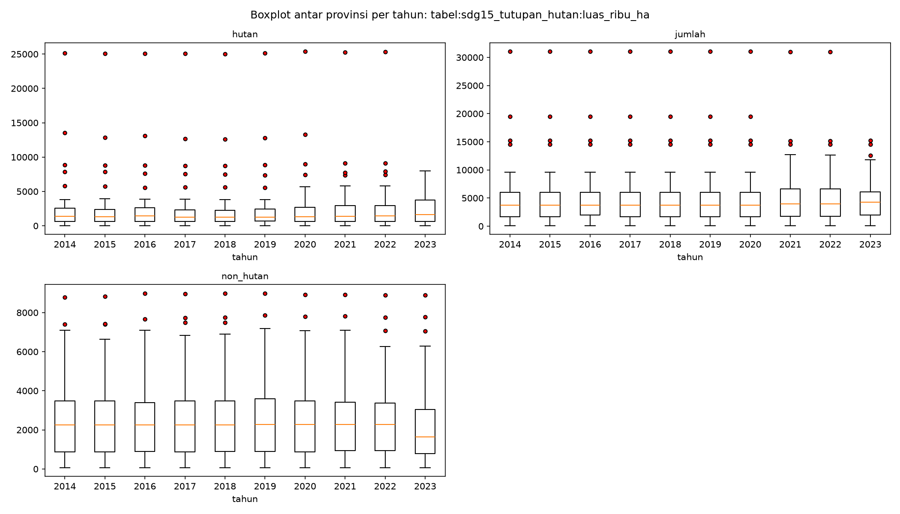
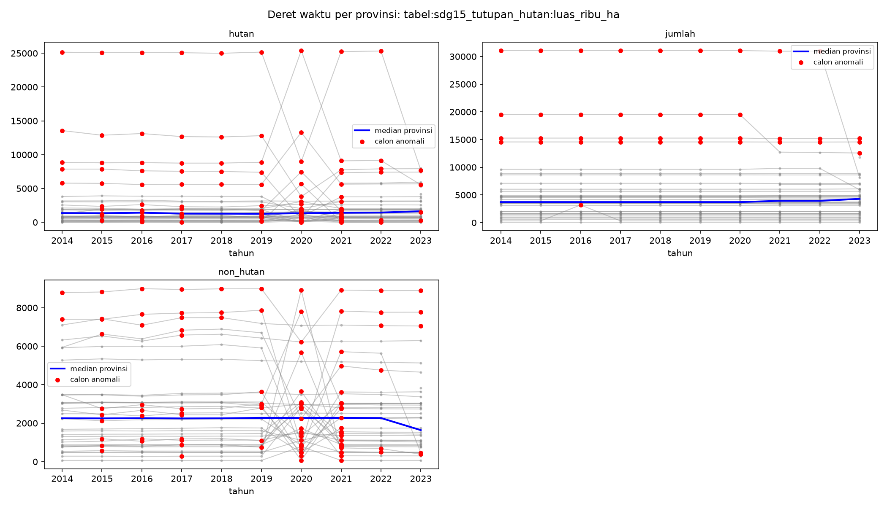
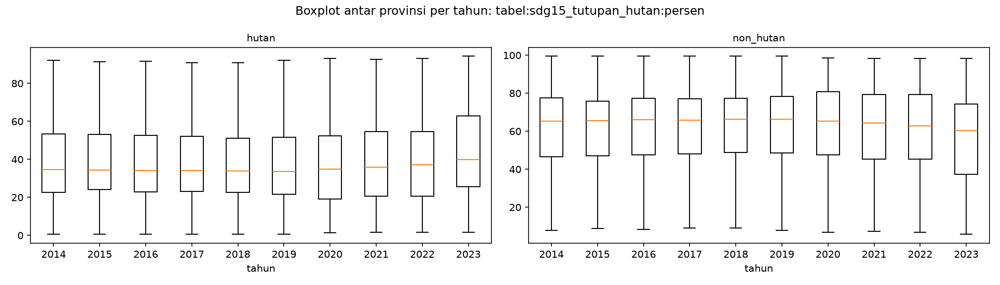
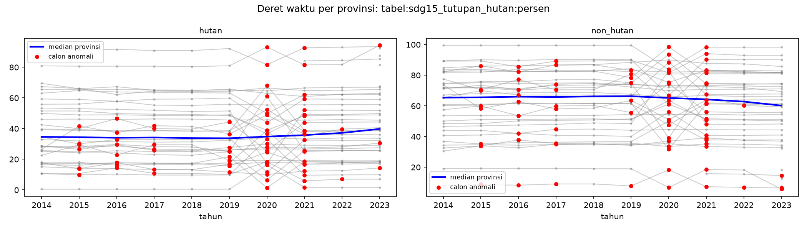
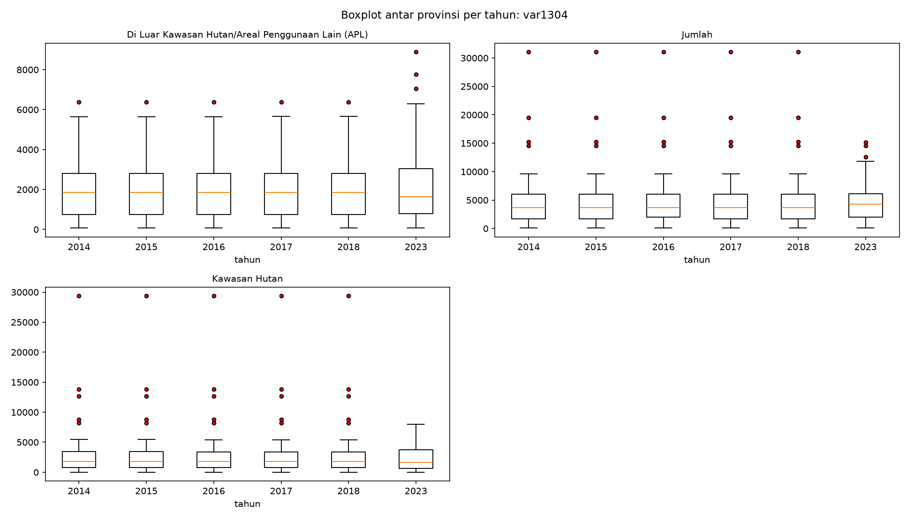
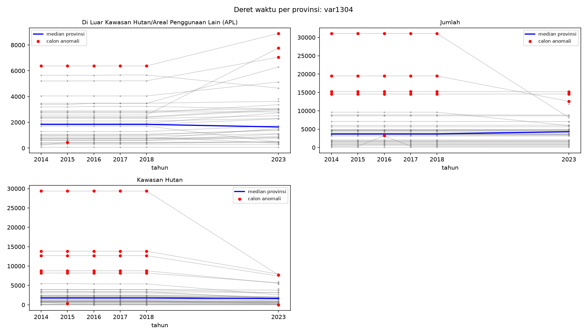
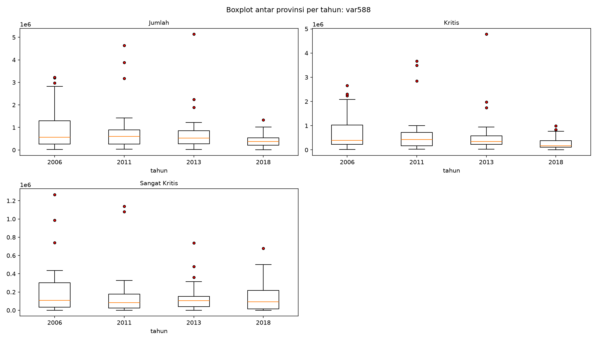
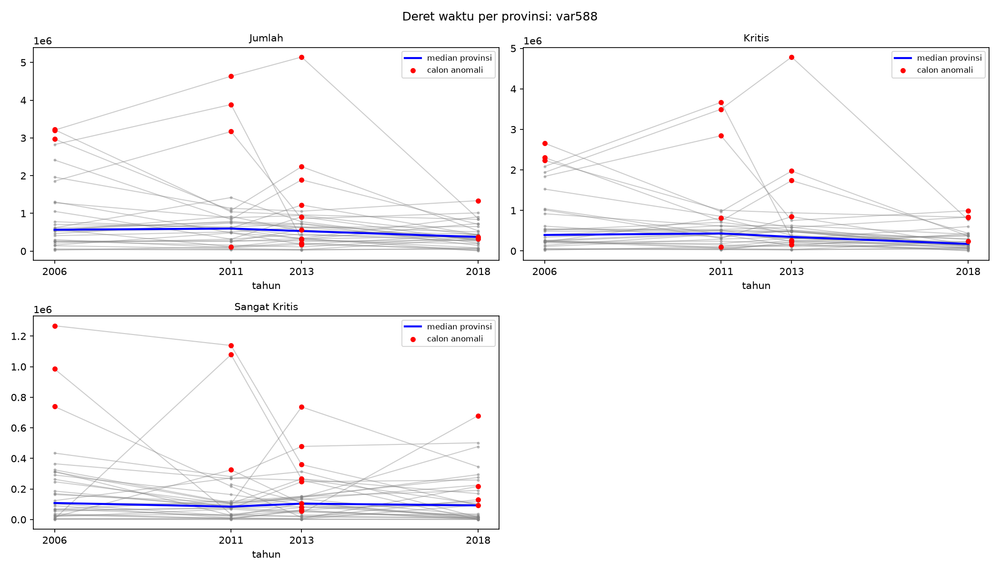
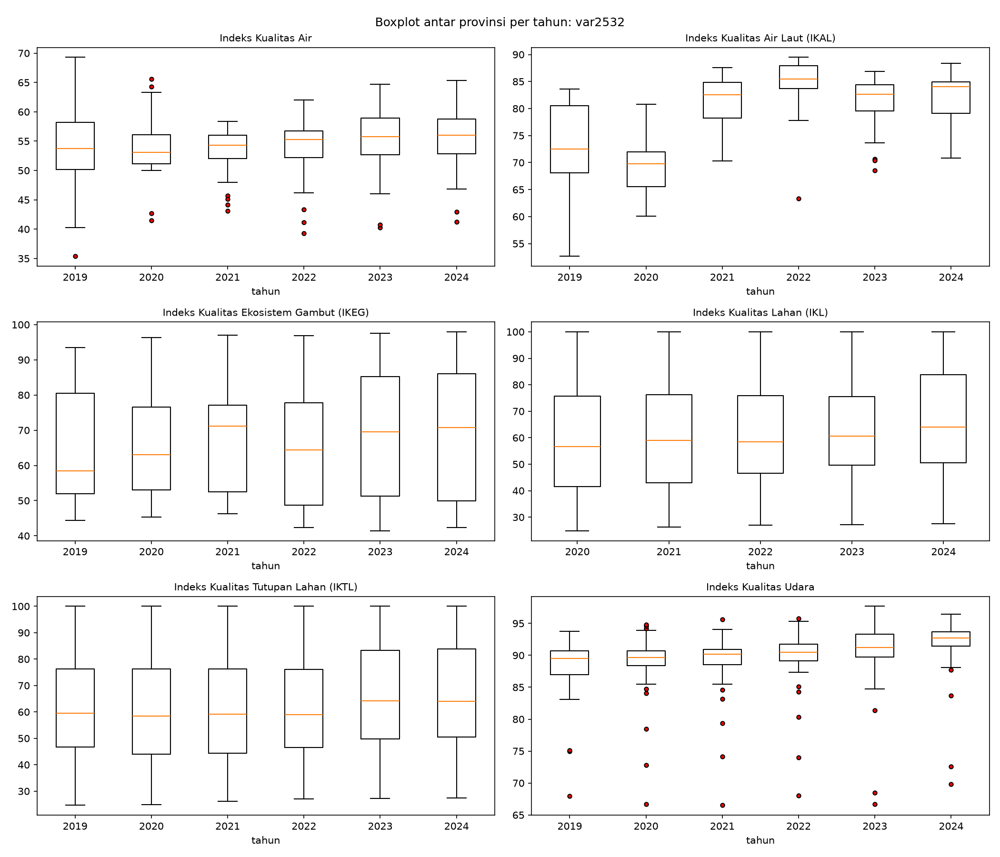
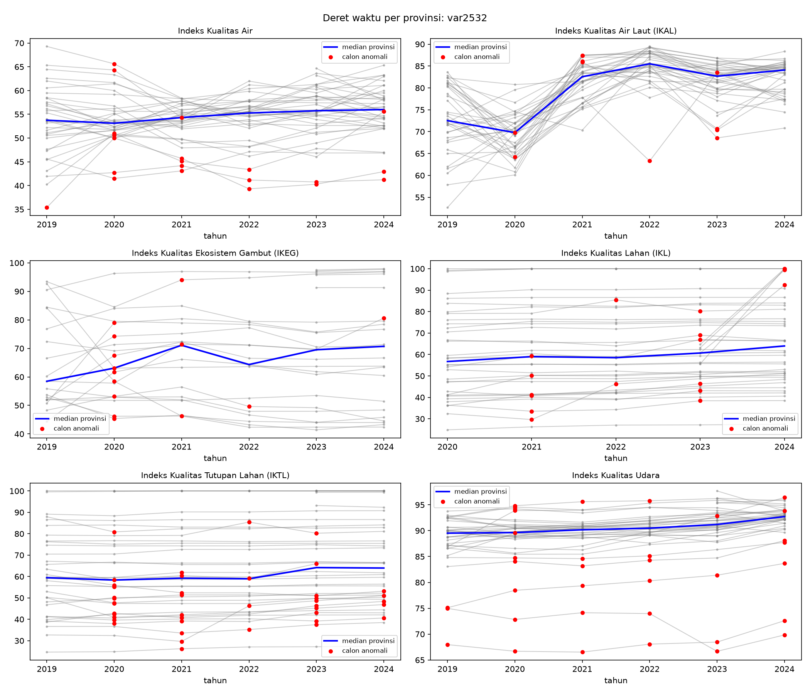

# Tahap 2: profil statistik dan calon anomali

Sumber: CSV mentah BPS di `data/raw/bps`. Tujuannya menemukan calon anomali; tidak ada nilai yang diperbaiki.

## Metode

- **Antar provinsi:** tiap seri × rincian × tahun dengan minimal 8 provinsi dinilai dengan z-score (|z| > 3) dan pagar IQR (1.5×IQR).
- **Loncatan:** perubahan relatif per tahun antara dua periode berurutan per provinsi, dikumpulkan per seri × rincian, lalu dinilai dengan ambang yang sama.
- Tidak ada uji z per deret provinsi: dengan n titik, |z| maksimum adalah (n-1)/√n (4 titik: 1,5; 10 titik: 2,85), sehingga ambang 3 tidak mungkin tercapai.
- `kuat` berarti lolos z-score dan IQR sekaligus.
- Luas absolut dipengaruhi ukuran provinsi, jadi tanda antar provinsi pada seri luas belum tentu galat.

## Ringkasan calon anomali
| seri | jenis | titik | kuat |
|---|---|---|---|
| tabel:sdg15_tutupan_hutan:luas_ribu_ha | antar_provinsi | 104 | 18 |
| tabel:sdg15_tutupan_hutan:luas_ribu_ha | loncatan | 177 | 6 |
| tabel:sdg15_tutupan_hutan:persen | loncatan | 169 | 10 |
| var1304 | antar_provinsi | 56 | 10 |
| var1304 | loncatan | 6 | 0 |
| var2532 | antar_provinsi | 50 | 9 |
| var2532 | loncatan | 97 | 17 |
| var588 | antar_provinsi | 31 | 10 |
| var588 | loncatan | 35 | 3 |

## tabel:sdg15_tutupan_hutan:luas_ribu_ha

### Profil per rincian
| rincian | n | n_kosong | rerata | sd | min | q1 | median | q3 | maks | iqr | cv_persen | satuan | n_provinsi | n_periode | periode_min | periode_maks |
|---|---|---|---|---|---|---|---|---|---|---|---|---|---|---|---|---|
| hutan | 337 | 7 | 2821.226 | 4566.850 | 0.300 | 647.400 | 1365.800 | 3012.600 | 25396.600 | 2365.200 | 161.875 | luas_ribu_ha | 38 | 10 | 2014 | 2023 |
| jumlah | 337 | 7 | 5579.650 | 5980.189 | 65.300 | 1680.200 | 3719.200 | 6053.300 | 31076.900 | 4373.100 | 107.179 | luas_ribu_ha | 38 | 10 | 2014 | 2023 |
| non_hutan | 337 | 7 | 2749.896 | 2326.690 | 64.400 | 879.400 | 2256.200 | 3474.100 | 8989.700 | 2594.700 | 84.610 | luas_ribu_ha | 38 | 10 | 2014 | 2023 |

### Calon anomali: 281 titik, 24 kuat

| rincian | wilayah | periode | nilai | jenis | z | alasan |
|---|---|---|---|---|---|---|
| hutan | DKI JAKARTA | 2020 | 152.900 | loncatan | 9.490 | dari 0.3 (2019) ke 152.9, +50866.7%/tahun: z=+9.49 (ambang ±3), di luar pagar IQR [-6.69; 6.96] |
| hutan | JAWA BARAT | 2021 | 686.500 | loncatan | 14.260 | dari 0.9 (2020) ke 686.5, +76177.8%/tahun: z=+14.26 (ambang ±3), di luar pagar IQR [-6.69; 6.96] |
| hutan | PAPUA | 2014 | 25155.500 | antar_provinsi | 4.500 | nilai 25155.5 dibanding provinsi lain tahun 2014: z=+4.50 (ambang ±3), di luar pagar IQR [-2234.95; 5440.65] |
| hutan | PAPUA | 2015 | 25088.400 | antar_provinsi | 4.540 | nilai 25088.4 dibanding provinsi lain tahun 2015: z=+4.54 (ambang ±3), di luar pagar IQR [-1938.25; 4922.95] |
| hutan | PAPUA | 2016 | 25082.600 | antar_provinsi | 4.540 | nilai 25082.6 dibanding provinsi lain tahun 2016: z=+4.54 (ambang ±3), di luar pagar IQR [-2301.40; 5569.00] |
| hutan | PAPUA | 2017 | 25076.900 | antar_provinsi | 4.570 | nilai 25076.9 dibanding provinsi lain tahun 2017: z=+4.57 (ambang ±3), di luar pagar IQR [-1836.20; 4788.60] |
| hutan | PAPUA | 2018 | 24993.600 | antar_provinsi | 4.570 | nilai 24993.6 dibanding provinsi lain tahun 2018: z=+4.57 (ambang ±3), di luar pagar IQR [-1791.25; 4691.55] |
| hutan | PAPUA | 2019 | 25168.700 | antar_provinsi | 4.570 | nilai 25168.7 dibanding provinsi lain tahun 2019: z=+4.57 (ambang ±3), di luar pagar IQR [-2026.05; 5150.35] |
| hutan | PAPUA | 2021 | 25241.300 | antar_provinsi | 4.860 | nilai 25241.3 dibanding provinsi lain tahun 2021: z=+4.86 (ambang ±3), di luar pagar IQR [-2792.10; 6401.10] |
| hutan | PAPUA | 2022 | 25321.900 | antar_provinsi | 4.860 | nilai 25321.9 dibanding provinsi lain tahun 2022: z=+4.86 (ambang ±3), di luar pagar IQR [-2818.96; 6438.34] |
| hutan | PAPUA BARAT | 2020 | 25396.600 | antar_provinsi | 4.540 | nilai 25396.6 dibanding provinsi lain tahun 2020: z=+4.54 (ambang ±3), di luar pagar IQR [-2412.30; 5712.50] |
| jumlah | PAPUA | 2014 | 31076.900 | antar_provinsi | 3.970 | nilai 31076.9 dibanding provinsi lain tahun 2014: z=+3.97 (ambang ±3), di luar pagar IQR [-4851.55; 12566.45] |
| jumlah | PAPUA | 2015 | 31076.900 | antar_provinsi | 3.970 | nilai 31076.9 dibanding provinsi lain tahun 2015: z=+3.97 (ambang ±3), di luar pagar IQR [-4851.55; 12566.45] |
| jumlah | PAPUA | 2016 | 31076.900 | antar_provinsi | 3.990 | nilai 31076.9 dibanding provinsi lain tahun 2016: z=+3.99 (ambang ±3), di luar pagar IQR [-4101.55; 12116.45] |
| jumlah | PAPUA | 2017 | 31076.900 | antar_provinsi | 3.970 | nilai 31076.9 dibanding provinsi lain tahun 2017: z=+3.97 (ambang ±3), di luar pagar IQR [-4851.55; 12566.45] |
| jumlah | PAPUA | 2018 | 31076.900 | antar_provinsi | 3.970 | nilai 31076.9 dibanding provinsi lain tahun 2018: z=+3.97 (ambang ±3), di luar pagar IQR [-4851.55; 12566.45] |
| jumlah | PAPUA | 2019 | 31076.900 | antar_provinsi | 3.970 | nilai 31076.9 dibanding provinsi lain tahun 2019: z=+3.97 (ambang ±3), di luar pagar IQR [-4851.55; 12566.45] |
| jumlah | PAPUA | 2020 | 31076.900 | antar_provinsi | 3.970 | nilai 31076.9 dibanding provinsi lain tahun 2020: z=+3.97 (ambang ±3), di luar pagar IQR [-4851.55; 12566.45] |
| jumlah | PAPUA | 2021 | 30958.300 | antar_provinsi | 4.290 | nilai 30958.3 dibanding provinsi lain tahun 2021: z=+4.29 (ambang ±3), di luar pagar IQR [-5612.40; 14019.60] |
| jumlah | PAPUA | 2022 | 30956.600 | antar_provinsi | 4.290 | nilai 30956.6 dibanding provinsi lain tahun 2022: z=+4.29 (ambang ±3), di luar pagar IQR [-5610.38; 14017.62] |
| non_hutan | BALI | 2020 | 8916.200 | loncatan | 5.600 | dari 467 (2019) ke 8916.2, +1809.3%/tahun: z=+5.60 (ambang ±3), di luar pagar IQR [-4.20; 3.89] |
| non_hutan | DKI JAKARTA | 2020 | 786.300 | loncatan | 3.380 | dari 65 (2019) ke 786.3, +1109.7%/tahun: z=+3.38 (ambang ±3), di luar pagar IQR [-4.20; 3.89] |
| non_hutan | JAWA BARAT | 2021 | 3032.700 | loncatan | 14.470 | dari 64.4 (2020) ke 3032.7, +4609.2%/tahun: z=+14.47 (ambang ±3), di luar pagar IQR [-4.20; 3.89] |
| non_hutan | JAWA TIMUR | 2021 | 3622.400 | loncatan | 3.390 | dari 299.1 (2020) ke 3622.4, +1111.1%/tahun: z=+3.39 (ambang ±3), di luar pagar IQR [-4.20; 3.89] |

Daftar lengkap (termasuk yang bukan kuat): `reports/tabel/calon_anomali.csv`.

## tabel:sdg15_tutupan_hutan:persen

### Profil per rincian
| rincian | n | n_kosong | rerata | sd | min | q1 | median | q3 | maks | iqr | cv_persen | satuan | n_provinsi | n_periode | periode_min | periode_maks |
|---|---|---|---|---|---|---|---|---|---|---|---|---|---|---|---|---|
| hutan | 337 | 7 | 39.188 | 22.423 | 0.500 | 21.600 | 35.200 | 55.400 | 94.300 | 33.800 | 57.219 | persen | 38 | 10 | 2014 | 2023 |
| non_hutan | 337 | 7 | 60.810 | 22.426 | 5.700 | 44.600 | 64.800 | 78.400 | 99.500 | 33.800 | 36.880 | persen | 38 | 10 | 2014 | 2023 |

### Calon anomali: 169 titik, 10 kuat

| rincian | wilayah | periode | nilai | jenis | z | alasan |
|---|---|---|---|---|---|---|
| hutan | DKI JAKARTA | 2020 | 16.300 | loncatan | 15.830 | dari 0.5 (2019) ke 16.3, +3160.0%/tahun: z=+15.83 (ambang ±3), di luar pagar IQR [-6.10; 6.42] |
| hutan | JAWA BARAT | 2021 | 18.500 | loncatan | 6.060 | dari 1.4 (2020) ke 18.5, +1221.4%/tahun: z=+6.06 (ambang ±3), di luar pagar IQR [-6.10; 6.42] |
| non_hutan | KALIMANTAN BARAT | 2021 | 61.300 | loncatan | 4.740 | dari 31.9 (2020) ke 61.3, +92.2%/tahun: z=+4.74 (ambang ±3), di luar pagar IQR [-3.96; 3.72] |
| non_hutan | KALIMANTAN SELATAN | 2021 | 74.900 | loncatan | 4.730 | dari 39 (2020) ke 74.9, +92.1%/tahun: z=+4.73 (ambang ±3), di luar pagar IQR [-3.96; 3.72] |
| non_hutan | PAPUA | 2020 | 6.800 | loncatan | -3.400 | dari 19 (2019) ke 6.8, -64.2%/tahun: z=-3.40 (ambang ±3), di luar pagar IQR [-3.96; 3.72] |
| non_hutan | PAPUA | 2021 | 18.500 | loncatan | 8.900 | dari 6.8 (2020) ke 18.5, +172.1%/tahun: z=+8.90 (ambang ±3), di luar pagar IQR [-3.96; 3.72] |
| non_hutan | PAPUA | 2023 | 5.700 | loncatan | -3.630 | dari 18.2 (2022) ke 5.7, -68.7%/tahun: z=-3.63 (ambang ±3), di luar pagar IQR [-3.96; 3.72] |
| non_hutan | PAPUA BARAT | 2020 | 18.300 | loncatan | 6.950 | dari 7.8 (2019) ke 18.3, +134.6%/tahun: z=+6.95 (ambang ±3), di luar pagar IQR [-3.96; 3.72] |
| non_hutan | PAPUA BARAT | 2021 | 7.300 | loncatan | -3.190 | dari 18.3 (2020) ke 7.3, -60.1%/tahun: z=-3.19 (ambang ±3), di luar pagar IQR [-3.96; 3.72] |
| non_hutan | SULAWESI TENGGARA | 2020 | 82.800 | loncatan | 3.620 | dari 48.5 (2019) ke 82.8, +70.7%/tahun: z=+3.62 (ambang ±3), di luar pagar IQR [-3.96; 3.72] |

Daftar lengkap (termasuk yang bukan kuat): `reports/tabel/calon_anomali.csv`.

## var1304

### Profil per rincian
| rincian | n | n_kosong | rerata | sd | min | q1 | median | q3 | maks | iqr | cv_persen | satuan | n_provinsi | n_periode | periode_min | periode_maks |
|---|---|---|---|---|---|---|---|---|---|---|---|---|---|---|---|---|
| Di Luar Kawasan Hutan/Areal Penggunaan Lain (APL) | 203 | 0 | 2108.046 | 1726.141 | 64.900 | 737.400 | 1841.000 | 2882.000 | 8893.400 | 2144.600 | 81.883 | Ribu Hektar | 38 | 6 | 2014 | 2023 |
| Jumlah | 203 | 0 | 5564.393 | 5917.924 | 65.300 | 1680.200 | 3723.400 | 6044.000 | 31076.900 | 4363.800 | 106.353 | Ribu Hektar | 38 | 6 | 2014 | 2023 |
| Kawasan Hutan | 203 | 0 | 3442.184 | 5231.533 | 0.500 | 700.400 | 1780.000 | 3493.700 | 29368.500 | 2793.300 | 151.983 | Ribu Hektar | 38 | 6 | 2014 | 2023 |

### Calon anomali: 62 titik, 10 kuat

| rincian | wilayah | periode | nilai | jenis | z | alasan |
|---|---|---|---|---|---|---|
| Jumlah | PAPUA | 2014 | 31076.900 | antar_provinsi | 3.970 | nilai 31076.9 dibanding provinsi lain tahun 2014: z=+3.97 (ambang ±3), di luar pagar IQR [-4851.55; 12566.45] |
| Jumlah | PAPUA | 2015 | 31076.900 | antar_provinsi | 3.970 | nilai 31076.9 dibanding provinsi lain tahun 2015: z=+3.97 (ambang ±3), di luar pagar IQR [-4851.55; 12566.45] |
| Jumlah | PAPUA | 2016 | 31076.900 | antar_provinsi | 3.990 | nilai 31076.9 dibanding provinsi lain tahun 2016: z=+3.99 (ambang ±3), di luar pagar IQR [-4101.55; 12116.45] |
| Jumlah | PAPUA | 2017 | 31076.900 | antar_provinsi | 3.970 | nilai 31076.9 dibanding provinsi lain tahun 2017: z=+3.97 (ambang ±3), di luar pagar IQR [-4851.55; 12566.45] |
| Jumlah | PAPUA | 2018 | 31076.900 | antar_provinsi | 3.970 | nilai 31076.9 dibanding provinsi lain tahun 2018: z=+3.97 (ambang ±3), di luar pagar IQR [-4851.55; 12566.45] |
| Kawasan Hutan | PAPUA | 2014 | 29368.500 | antar_provinsi | 4.480 | nilai 29368.5 dibanding provinsi lain tahun 2014: z=+4.48 (ambang ±3), di luar pagar IQR [-3085.80; 7320.60] |
| Kawasan Hutan | PAPUA | 2015 | 29368.500 | antar_provinsi | 4.480 | nilai 29368.5 dibanding provinsi lain tahun 2015: z=+4.48 (ambang ±3), di luar pagar IQR [-3085.80; 7320.60] |
| Kawasan Hutan | PAPUA | 2016 | 29368.500 | antar_provinsi | 4.480 | nilai 29368.5 dibanding provinsi lain tahun 2016: z=+4.48 (ambang ±3), di luar pagar IQR [-3071.70; 7297.10] |
| Kawasan Hutan | PAPUA | 2017 | 29368.500 | antar_provinsi | 4.480 | nilai 29368.5 dibanding provinsi lain tahun 2017: z=+4.48 (ambang ±3), di luar pagar IQR [-3071.70; 7297.10] |
| Kawasan Hutan | PAPUA | 2018 | 29368.500 | antar_provinsi | 4.480 | nilai 29368.5 dibanding provinsi lain tahun 2018: z=+4.48 (ambang ±3), di luar pagar IQR [-3070.05; 7294.35] |

Daftar lengkap (termasuk yang bukan kuat): `reports/tabel/calon_anomali.csv`.

## var588

### Profil per rincian
| rincian | n | n_kosong | rerata | sd | min | q1 | median | q3 | maks | iqr | cv_persen | satuan | n_provinsi | n_periode | periode_min | periode_maks |
|---|---|---|---|---|---|---|---|---|---|---|---|---|---|---|---|---|
| Jumlah | 129 | 0 | 742646.380 | 892264.184 | 8230.000 | 261526.000 | 487343.000 | 840914.000 | 5144704.000 | 579388.000 | 120.147 | Hektar | 33 | 4 | 2006 | 2018 |
| Kritis | 129 | 0 | 576360.101 | 765804.083 | 4269.000 | 155587.000 | 339055.000 | 614117.000 | 4785299.000 | 458530.000 | 132.869 | Hektar | 33 | 4 | 2006 | 2018 |
| Sangat Kritis | 129 | 0 | 166286.326 | 226808.498 | 30.000 | 23248.000 | 97153.000 | 230230.000 | 1267743.000 | 206982.000 | 136.396 | Hektar | 33 | 4 | 2006 | 2018 |

### Calon anomali: 66 titik, 13 kuat

| rincian | wilayah | periode | nilai | jenis | z | alasan |
|---|---|---|---|---|---|---|
| Jumlah | BANTEN | 2018 | 330407.000 | loncatan | 5.180 | dari 36955 (2013) ke 330407, +158.8%/tahun: z=+5.18 (ambang ±3), di luar pagar IQR [-45.53; 41.76] |
| Jumlah | KALIMANTAN TENGAH | 2011 | 4636890.000 | antar_provinsi | 3.520 | nilai 4.63689e+06 dibanding provinsi lain tahun 2011: z=+3.52 (ambang ±3), di luar pagar IQR [-699892.25; 1850671.75] |
| Jumlah | KALIMANTAN TENGAH | 2013 | 5144704.000 | antar_provinsi | 4.730 | nilai 5.1447e+06 dibanding provinsi lain tahun 2013: z=+4.73 (ambang ±3), di luar pagar IQR [-603512.50; 1737427.50] |
| Kritis | KALIMANTAN TENGAH | 2011 | 3498036.000 | antar_provinsi | 3.070 | nilai 3.49804e+06 dibanding provinsi lain tahun 2011: z=+3.07 (ambang ±3), di luar pagar IQR [-634164.38; 1526228.62] |
| Kritis | KALIMANTAN TENGAH | 2013 | 4785299.000 | antar_provinsi | 4.850 | nilai 4.7853e+06 dibanding provinsi lain tahun 2013: z=+4.85 (ambang ±3), di luar pagar IQR [-311338.50; 1116313.50] |
| Kritis | KEP. RIAU | 2013 | 224031.000 | loncatan | 8.050 | dari 24519 (2011) ke 224031, +406.9%/tahun: z=+8.05 (ambang ±3), di luar pagar IQR [-50.88; 48.23] |
| Kritis | SUMATERA SELATAN | 2011 | 3668355.000 | antar_provinsi | 3.250 | nilai 3.66836e+06 dibanding provinsi lain tahun 2011: z=+3.25 (ambang ±3), di luar pagar IQR [-634164.38; 1526228.62] |
| Sangat Kritis | JAMBI | 2011 | 1078917.000 | antar_provinsi | 3.460 | nilai 1.07892e+06 dibanding provinsi lain tahun 2011: z=+3.46 (ambang ±3), di luar pagar IQR [-200506.00; 403512.00] |
| Sangat Kritis | JAMBI | 2011 | 1078917.000 | loncatan | 9.290 | dari 4774 (2006) ke 1.07892e+06, +4500.0%/tahun: z=+9.29 (ambang ±3), di luar pagar IQR [-62.27; 63.84] |
| Sangat Kritis | JAWA BARAT | 2018 | 679748.000 | antar_provinsi | 3.220 | nilai 679748 dibanding provinsi lain tahun 2018: z=+3.22 (ambang ±3), di luar pagar IQR [-290198.50; 521893.50] |
| Sangat Kritis | JAWA TIMUR | 2013 | 736877.000 | antar_provinsi | 3.790 | nilai 736877 dibanding provinsi lain tahun 2013: z=+3.79 (ambang ±3), di luar pagar IQR [-125339.50; 318104.50] |
| Sangat Kritis | KALIMANTAN TENGAH | 2006 | 1267743.000 | antar_provinsi | 3.560 | nilai 1.26774e+06 dibanding provinsi lain tahun 2006: z=+3.56 (ambang ±3), di luar pagar IQR [-368929.50; 703282.50] |
| Sangat Kritis | KALIMANTAN TENGAH | 2011 | 1138854.000 | antar_provinsi | 3.690 | nilai 1.13885e+06 dibanding provinsi lain tahun 2011: z=+3.69 (ambang ±3), di luar pagar IQR [-200506.00; 403512.00] |

Daftar lengkap (termasuk yang bukan kuat): `reports/tabel/calon_anomali.csv`.

## var2532

### Profil per rincian
| rincian | n | n_kosong | rerata | sd | min | q1 | median | q3 | maks | iqr | cv_persen | satuan | n_provinsi | n_periode | periode_min | periode_maks |
|---|---|---|---|---|---|---|---|---|---|---|---|---|---|---|---|---|
| Indeks Kualitas Air | 212 | 0 | 54.307 | 5.670 | 35.370 | 51.782 | 54.750 | 57.843 | 69.290 | 6.060 | 10.441 |  | 38 | 6 | 2019 | 2024 |
| Indeks Kualitas Air Laut (IKAL) | 209 | 0 | 78.730 | 7.625 | 52.650 | 73.670 | 81.210 | 84.560 | 89.480 | 10.890 | 9.685 |  | 37 | 6 | 2019 | 2024 |
| Indeks Kualitas Ekosistem Gambut (IKEG) | 122 | 0 | 67.231 | 17.282 | 41.430 | 52.000 | 66.365 | 79.175 | 97.960 | 27.175 | 25.705 |  | 23 | 6 | 2019 | 2024 |
| Indeks Kualitas Lahan (IKL) | 178 | 0 | 62.851 | 20.180 | 24.860 | 47.360 | 59.335 | 76.625 | 100.000 | 29.265 | 32.108 |  | 38 | 5 | 2020 | 2024 |
| Indeks Kualitas Tutupan Lahan (IKTL) | 211 | 0 | 63.489 | 20.553 | 24.660 | 47.390 | 59.630 | 79.290 | 100.000 | 31.900 | 32.373 |  | 38 | 6 | 2019 | 2024 |
| Indeks Kualitas Udara | 212 | 0 | 89.292 | 5.766 | 66.520 | 88.728 | 90.515 | 92.433 | 97.680 | 3.705 | 6.458 |  | 38 | 6 | 2019 | 2024 |

### Calon anomali: 147 titik, 26 kuat

| rincian | wilayah | periode | nilai | jenis | z | alasan |
|---|---|---|---|---|---|---|
| Indeks Kualitas Air | DI YOGYAKARTA | 2020 | 50.000 | loncatan | 5.500 | dari 35.37 (2019) ke 50, +41.4%/tahun: z=+5.50 (ambang ±3), di luar pagar IQR [-15.17; 16.58] |
| Indeks Kualitas Air | NUSA TENGGARA BARAT | 2020 | 50.980 | loncatan | 3.510 | dari 40.23 (2019) ke 50.98, +26.7%/tahun: z=+3.51 (ambang ±3), di luar pagar IQR [-15.17; 16.58] |
| Indeks Kualitas Air Laut (IKAL) | BANTEN | 2021 | 85.920 | loncatan | 3.260 | dari 60.12 (2020) ke 85.92, +42.9%/tahun: z=+3.26 (ambang ±3), di luar pagar IQR [-23.04; 27.89] |
| Indeks Kualitas Air Laut (IKAL) | JAWA BARAT | 2021 | 87.420 | loncatan | 3.320 | dari 60.83 (2020) ke 87.42, +43.7%/tahun: z=+3.32 (ambang ±3), di luar pagar IQR [-23.04; 27.89] |
| Indeks Kualitas Air Laut (IKAL) | KALIMANTAN BARAT | 2022 | 63.300 | antar_provinsi | -4.500 | nilai 63.3 dibanding provinsi lain tahun 2022: z=-4.50 (ambang ±3), di luar pagar IQR [77.32; 94.25] |
| Indeks Kualitas Air Laut (IKAL) | SULAWESI TENGAH | 2021 | 87.360 | loncatan | 3.140 | dari 61.76 (2020) ke 87.36, +41.5%/tahun: z=+3.14 (ambang ±3), di luar pagar IQR [-23.04; 27.89] |
| Indeks Kualitas Ekosistem Gambut (IKEG) | KALIMANTAN TENGAH | 2020 | 78.980 | loncatan | 5.120 | dari 50.72 (2019) ke 78.98, +55.7%/tahun: z=+5.12 (ambang ±3), di luar pagar IQR [-12.07; 9.92] |
| Indeks Kualitas Ekosistem Gambut (IKEG) | SUMATERA SELATAN | 2020 | 61.700 | loncatan | 3.600 | dari 44.32 (2019) ke 61.7, +39.2%/tahun: z=+3.60 (ambang ±3), di luar pagar IQR [-12.07; 9.92] |
| Indeks Kualitas Lahan (IKL) | DI YOGYAKARTA | 2022 | 46.280 | loncatan | 4.500 | dari 29.66 (2021) ke 46.28, +56.0%/tahun: z=+4.50 (ambang ±3), di luar pagar IQR [-4.38; 7.06] |
| Indeks Kualitas Lahan (IKL) | PAPUA BARAT DAYA | 2024 | 100.000 | loncatan | 6.530 | dari 55.61 (2023) ke 100, +79.8%/tahun: z=+6.53 (ambang ±3), di luar pagar IQR [-4.38; 7.06] |
| Indeks Kualitas Lahan (IKL) | PAPUA PEGUNUNGAN | 2024 | 99.420 | loncatan | 4.610 | dari 63.18 (2023) ke 99.42, +57.4%/tahun: z=+4.61 (ambang ±3), di luar pagar IQR [-4.38; 7.06] |
| Indeks Kualitas Lahan (IKL) | PAPUA SELATAN | 2024 | 92.360 | loncatan | 4.160 | dari 60.73 (2023) ke 92.36, +52.1%/tahun: z=+4.16 (ambang ±3), di luar pagar IQR [-4.38; 7.06] |
| Indeks Kualitas Lahan (IKL) | PAPUA TENGAH | 2024 | 100.000 | loncatan | 4.380 | dari 64.67 (2023) ke 100, +54.6%/tahun: z=+4.38 (ambang ±3), di luar pagar IQR [-4.38; 7.06] |
| Indeks Kualitas Tutupan Lahan (IKTL) | DI YOGYAKARTA | 2022 | 46.280 | loncatan | 10.190 | dari 29.66 (2021) ke 46.28, +56.0%/tahun: z=+10.19 (ambang ±3), di luar pagar IQR [-2.08; 3.13] |
| Indeks Kualitas Tutupan Lahan (IKTL) | JAWA TENGAH | 2020 | 41.030 | loncatan | -3.460 | dari 50.08 (2019) ke 41.03, -18.1%/tahun: z=-3.46 (ambang ±3), di luar pagar IQR [-2.08; 3.13] |
| Indeks Kualitas Udara | BANTEN | 2023 | 66.670 | antar_provinsi | -3.730 | nilai 66.67 dibanding provinsi lain tahun 2023: z=-3.73 (ambang ±3), di luar pagar IQR [84.46; 98.59] |
| Indeks Kualitas Udara | BANTEN | 2023 | 66.670 | loncatan | -5.870 | dari 73.97 (2022) ke 66.67, -9.9%/tahun: z=-5.87 (ambang ±3), di luar pagar IQR [-2.58; 3.71] |
| Indeks Kualitas Udara | BANTEN | 2024 | 69.840 | antar_provinsi | -4.000 | nilai 69.84 dibanding provinsi lain tahun 2024: z=-4.00 (ambang ±3), di luar pagar IQR [88.02; 97.14] |
| Indeks Kualitas Udara | DKI JAKARTA | 2019 | 67.970 | antar_provinsi | -3.610 | nilai 67.97 dibanding provinsi lain tahun 2019: z=-3.61 (ambang ±3), di luar pagar IQR [81.32; 96.31] |
| Indeks Kualitas Udara | DKI JAKARTA | 2020 | 66.690 | antar_provinsi | -3.770 | nilai 66.69 dibanding provinsi lain tahun 2020: z=-3.77 (ambang ±3), di luar pagar IQR [84.93; 94.21] |
| Indeks Kualitas Udara | DKI JAKARTA | 2021 | 66.520 | antar_provinsi | -3.890 | nilai 66.52 dibanding provinsi lain tahun 2021: z=-3.89 (ambang ±3), di luar pagar IQR [84.99; 94.46] |
| Indeks Kualitas Udara | DKI JAKARTA | 2022 | 68.060 | antar_provinsi | -3.800 | nilai 68.06 dibanding provinsi lain tahun 2022: z=-3.80 (ambang ±3), di luar pagar IQR [85.26; 95.69] |
| Indeks Kualitas Udara | DKI JAKARTA | 2023 | 68.460 | antar_provinsi | -3.450 | nilai 68.46 dibanding provinsi lain tahun 2023: z=-3.45 (ambang ±3), di luar pagar IQR [84.46; 98.59] |
| Indeks Kualitas Udara | DKI JAKARTA | 2024 | 72.590 | antar_provinsi | -3.490 | nilai 72.59 dibanding provinsi lain tahun 2024: z=-3.49 (ambang ±3), di luar pagar IQR [88.02; 97.14] |
| Indeks Kualitas Udara | DKI JAKARTA | 2024 | 72.590 | loncatan | 3.010 | dari 68.46 (2023) ke 72.59, +6.0%/tahun: z=+3.01 (ambang ±3), di luar pagar IQR [-2.58; 3.71] |
| Indeks Kualitas Udara | GORONTALO | 2020 | 93.890 | loncatan | 4.150 | dari 86.88 (2019) ke 93.89, +8.1%/tahun: z=+4.15 (ambang ±3), di luar pagar IQR [-2.58; 3.71] |

Daftar lengkap (termasuk yang bukan kuat): `reports/tabel/calon_anomali.csv`.

## Ketidakkonsistenan bawaan tabel tutupan hutan

Baris yang ditandai kolom `cek` oleh sumber, atau yang selisih hutan + non_hutan terhadap jumlah lebih dari 0,5 ribu ha. Daftar lengkap: `reports/tabel/calon_anomali_cek_bawaan.csv`.

Total: 26 pasangan wilayah-tahun.

| tahun | jumlah_wilayah |
|---|---|
| 2016 | 1 |
| 2020 | 25 |

| wilayah | tahun | hutan | non_hutan | jumlah | selisih | hutan_dari_persen | hn_sama_dengan_jumlah_milik | alasan |
|---|---|---|---|---|---|---|---|---|
| BALI | 2020 | 5656.600 | 8916.200 | 566.900 | 14005.900 | 220.000 | KALIMANTAN BARAT | hutan + non_hutan - jumlah = 14005.9 ribu ha |
| BANTEN | 2020 | 1192.600 | 3645.100 | 939.200 | 3898.500 | 232.000 | JAWA TIMUR | hutan + non_hutan - jumlah = 3898.5 ribu ha |
| BENGKULU | 2020 | 191.900 | 1467.800 | 2002.900 | -343.200 | 232.300 | KEP. BANGKA BELITUNG | hutan + non_hutan - jumlah = -343.2 ribu ha |
| DI YOGYAKARTA | 2016 | 45.900 | 273.500 | 3194.000 | -2874.600 | 459.900 | DI YOGYAKARTA | hutan + non_hutan - jumlah = -2874.6 ribu ha |
| DI YOGYAKARTA | 2020 | 634.500 | 2822.100 | 319.400 | 3137.200 | 58.800 | JAWA TENGAH | hutan + non_hutan - jumlah = 3137.2 ribu ha |
| DKI JAKARTA | 2020 | 152.900 | 786.300 | 65.300 | 873.900 | 10.600 | BANTEN | hutan + non_hutan - jumlah = 873.9 ribu ha |
| GORONTALO | 2020 | 869.600 | 1110.600 | 1198.500 | 781.700 | 526.100 | NUSA TENGGARA BARAT | hutan + non_hutan - jumlah = 781.7 ribu ha |
| JAWA BARAT | 2020 | 0.900 | 64.400 | 3698.600 | -3633.300 | 51.800 | DKI JAKARTA | hutan + non_hutan - jumlah = -3633.3 ribu ha |
| JAWA TENGAH | 2020 | 710.400 | 2988.200 | 3456.600 | 242.000 | 663.700 | JAWA BARAT | hutan + non_hutan - jumlah = 242.0 ribu ha |
| JAWA TIMUR | 2020 | 20.300 | 299.100 | 4837.700 | -4518.300 | 309.600 | DI YOGYAKARTA | hutan + non_hutan - jumlah = -4518.3 ribu ha |
| KALIMANTAN BARAT | 2020 | 13289.500 | 6215.300 | 14572.800 | 4932.000 | 9924.100 | KALIMANTAN TIMUR | hutan + non_hutan - jumlah = 4932.0 ribu ha |
| KALIMANTAN SELATAN | 2020 | 731.100 | 467.400 | 3713.900 | -2515.400 | 2265.500 | GORONTALO | hutan + non_hutan - jumlah = -2515.4 ribu ha |
| KALIMANTAN TENGAH | 2020 | 560.000 | 879.500 | 15266.200 | -13826.700 | 5938.600 | SULAWESI UTARA | hutan + non_hutan - jumlah = -13826.7 ribu ha |
| KALIMANTAN TIMUR | 2020 | 3802.400 | 2232.300 | 19504.800 | -13470.100 | 12288.000 | SULAWESI TENGAH | hutan + non_hutan - jumlah = -13470.1 ribu ha |
| KEP. BANGKA BELITUNG | 2020 | 344.200 | 3091.200 | 1659.700 | 1775.700 | 166.000 | LAMPUNG | hutan + non_hutan - jumlah = 1775.7 ribu ha |
| LAMPUNG | 2020 | 665.000 | 1337.900 | 3435.400 | -1432.500 | 1140.600 | BENGKULU | hutan + non_hutan - jumlah = -1432.5 ribu ha |
| MALUKU | 2020 | 2023.200 | 1107.400 | 4622.100 | -1491.500 | 2985.900 | MALUKU UTARA | hutan + non_hutan - jumlah = -1491.5 ribu ha |
| MALUKU UTARA | 2020 | 3075.500 | 1546.600 | 3130.600 | 1491.500 | 2081.800 | MALUKU | hutan + non_hutan - jumlah = 1491.5 ribu ha |
| NUSA TENGGARA BARAT | 2020 | 948.500 | 2765.400 | 1980.200 | 1733.700 | 505.000 | KALIMANTAN SELATAN | hutan + non_hutan - jumlah = 1733.7 ribu ha |
| NUSA TENGGARA TIMUR | 2020 | 7459.300 | 7806.900 | 4722.500 | 10543.700 | 2309.300 | KALIMANTAN TENGAH | hutan + non_hutan - jumlah = 10543.7 ribu ha |
| PAPUA | 2020 | 8967.300 | 657.600 | 31076.900 | -21452.000 | 28963.700 | PAPUA BARAT | hutan + non_hutan - jumlah = -21452.0 ribu ha |
| PAPUA BARAT | 2020 | 25396.600 | 5680.300 | 9624.900 | 21452.000 | 7863.500 | PAPUA | hutan + non_hutan - jumlah = 21452.0 ribu ha |
| SULAWESI BARAT | 2020 | 1725.400 | 2997.100 | 1680.200 | 3042.300 | 613.300 | NUSA TENGGARA TIMUR | hutan + non_hutan - jumlah = 3042.3 ribu ha |
| SULAWESI TENGAH | 2020 | 837.600 | 842.600 | 6034.700 | -4354.500 | 3011.300 | SULAWESI BARAT | hutan + non_hutan - jumlah = -4354.5 ribu ha |
| SULAWESI TENGGARA | 2020 | 97.500 | 469.400 | 3611.600 | -3044.700 | 621.200 | BALI | hutan + non_hutan - jumlah = -3044.7 ribu ha |
| SULAWESI UTARA | 2020 | 1891.200 | 1720.400 | 1439.500 | 2172.100 | 754.300 | SULAWESI TENGGARA | hutan + non_hutan - jumlah = 2172.1 ribu ha |

## Nilai kosong di berkas mentah

| seri | rincian | wilayah | n | periode_kosong | alasan |
|---|---|---|---|---|---|
| tabel:sdg15_tutupan_hutan:luas_ribu_ha | hutan | KALIMANTAN UTARA | 7 | 2014, 2015, 2016, 2017, 2018, 2019, 2020 | nilai kosong di berkas mentah (KASUS.md menyebut mentah tanpa baris kosong) |
| tabel:sdg15_tutupan_hutan:luas_ribu_ha | jumlah | KALIMANTAN UTARA | 7 | 2014, 2015, 2016, 2017, 2018, 2019, 2020 | nilai kosong di berkas mentah (KASUS.md menyebut mentah tanpa baris kosong) |
| tabel:sdg15_tutupan_hutan:luas_ribu_ha | non_hutan | KALIMANTAN UTARA | 7 | 2014, 2015, 2016, 2017, 2018, 2019, 2020 | nilai kosong di berkas mentah (KASUS.md menyebut mentah tanpa baris kosong) |
| tabel:sdg15_tutupan_hutan:persen | hutan | KALIMANTAN UTARA | 7 | 2014, 2015, 2016, 2017, 2018, 2019, 2020 | nilai kosong di berkas mentah (KASUS.md menyebut mentah tanpa baris kosong) |
| tabel:sdg15_tutupan_hutan:persen | non_hutan | KALIMANTAN UTARA | 7 | 2014, 2015, 2016, 2017, 2018, 2019, 2020 | nilai kosong di berkas mentah (KASUS.md menyebut mentah tanpa baris kosong) |

## Catatan dari sumber (kolom catatan)

| wilayah | catatan | tahun |
|---|---|---|
| KALIMANTAN TIMUR | gabungan Kalimantan Timur dan Kalimantan Utara | 2014, 2015, 2016, 2017, 2018, 2019, 2020, 2021, 2022 |
